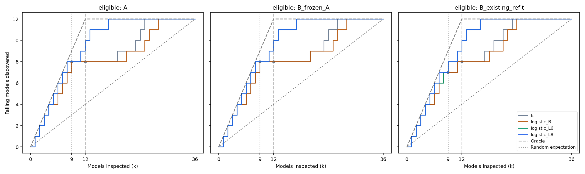
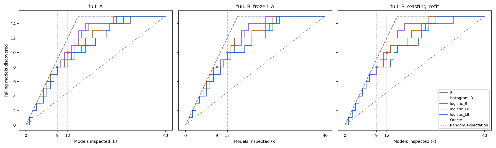
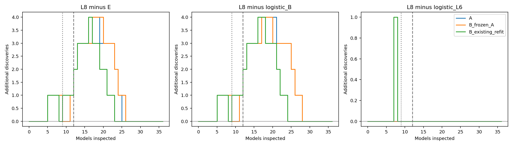
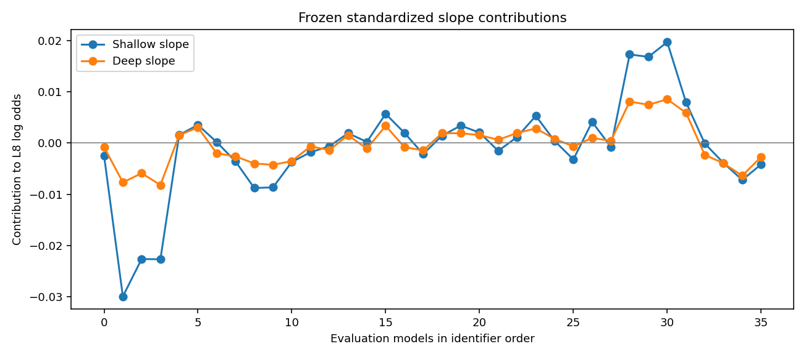
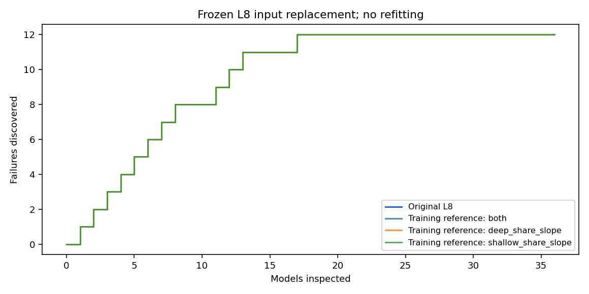
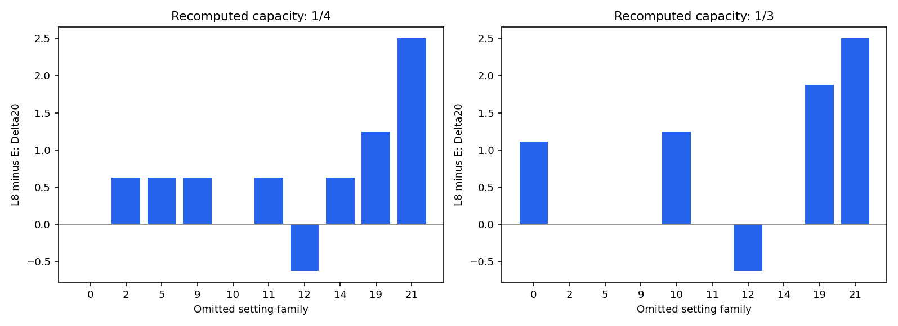

# GradientGuard diagnostic follow-up — 18 November 2026

**Encouraging added discovery at some audit capacities, with temporal-slope specificity unsupported.**

Recommendation: **Revise the contribution toward order-free layer summaries; pursue separately frozen independent validation and novelty assessment.**

This analysis is post-hoc. All outcomes were already known before this diagnostic plan was frozen. It changes no original model, forecast, label, family, threshold or scientific decision. Small improvements are highlighted below with their scope and limitations.

## Audit capacity: primary source-normal cohort

There are 36 models, 12 failures, nine eligible setting families and ten original held-out families. Nine audits are 25%; twelve audits are one third. Discovery counts:

| model | nine_audits | twelve_audits |
| --- | --- | --- |
| E | 8 | 8 |
| logistic_B | 8 | 8 |
| logistic_L6 | 8 | 10 |
| logistic_L8 | 8 | 10 |

At nine audits every primary method still discovers eight failures. The original result is unchanged. The oracle ceiling is nine, leaving E room for only one extra discovery and a maximum Delta20 headroom of 20/36=0.5556, below the original target of 1. Increasing capacity creates a different decision; it cannot retrospectively validate the original primary hypothesis.

All budget directions, including losses and ties, are reported rather than selecting only a favourable budget:

| control | positive_budgets | negative_budgets | tied_budget_count | max_extra_discoveries | minimum_difference |
| --- | --- | --- | --- | --- | --- |
| E | 5,6,7,8,11,12,13,14,15,16,17,18,19,20,21,22,23,24 | none | 19 | 4 | 0 |
| logistic_B | 5,6,7,8,11,12,13,14,15,16,17,18,19,20,21,22,23,24,25,26,27 | none | 16 | 4 | 0 |
| logistic_L6 | none | none | 37 | 0 | 0 |

Earliest budget recovering every observed failure (descriptive, selected using known outcomes):

| cohort | variant | model | F | first_k_all_failures_found |
| --- | --- | --- | --- | --- |
| eligible | A | E | 12 | 25 |
| eligible | A | logistic_B | 12 | 28 |
| eligible | A | logistic_L6 | 12 | 17 |
| eligible | A | logistic_L8 | 12 | 17 |

The complete 0..N curves, random expectations, oracle ceilings, precision, recall, headroom and paired differences are in all_budget_curves.csv and all_budget_contrasts.csv. At k=0 precision is undefined; at full capacity all observed failures are recovered. Rank tables identify the actual audit selections.

## Slopes and preprocessing

All frozen pipeline predictions were re-evaluated and compared with the original saved predictions before interpreting slope changes. Feature construction was independently adapted read-only and checked against both development/evaluation panel-A exports. No classifier or forecaster fitting occurred.

| feature | retained | training_mean | training_scale | fitted_variance | coefficient | standardized_min | standardized_max | contribution_mean_absolute | contribution_max_absolute |
| --- | --- | --- | --- | --- | --- | --- | --- | --- | --- |
| shallow_share_slope | True | -0.44599 | 1.6209 | 2.6274 | 0.011751 | -2.546 | 1.677 | 0.0061808 | 0.029918 |
| deep_share_slope | True | 0.64718 | 1.9894 | 3.9576 | -0.0044403 | -1.9238 | 1.8422 | 0.0031307 | 0.0085422 |

The lineage table traces all input columns through imputation, scaling and constant filtering to estimator indices. Variation tables report missingness, distinct values and population SD. A retained, varying feature can still make only a small contribution. Coefficients are conditional associations and can share information with correlated conventional/static features.

L6/L8 equality checks (do not infer probability/ranking equality from equal AP/AUROC):

| k | probabilities_exact | probabilities_close | max_absolute_probability_difference | complete_order_identical | selected_set_identical | selected_overlap | AP_L6 | AP_L8 | AUROC_L6 | AUROC_L8 |
| --- | --- | --- | --- | --- | --- | --- | --- | --- | --- | --- |
| 9 | False | False | 0.0029544 | False | True | 9 | 0.93363 | 0.93363 | 0.96181 | 0.96181 |
| 12 | False | False | 0.0029544 | False | False | 11 | 0.93363 | 0.93363 | 0.96181 | 0.96181 |

Primary L6 C=0.1, L8 C=0.1. The maximum absolute difference in shared standardized coefficients is 0.00184341; maximum common training-mean difference is 0. L6 and L8 are separately fitted historical models; their comparison is not simply deleting two coefficients from the same fit. Full-cohort and panel-specific hyperparameters and coefficients are retained in common_coefficients.csv.

## Frozen L8 slope-reference replacement

Each slope, and then both slopes, was replaced with the fitted development-training scaler mean in imputed input space. All other input values were preserved. Replacement produces zero standardized slope values and its logit difference was verified against the negative sum of removed coefficient contributions.

| replacement | k | max_absolute_probability_change | max_logit_identity_error | complete_order_identical | selected_set_identical | original_discoveries | replacement_discoveries |
| --- | --- | --- | --- | --- | --- | --- | --- |
| shallow_share_slope | 9 | 0.0047606 | 4.996e-16 | False | True | 8 | 8 |
| shallow_share_slope | 12 | 0.0047606 | 4.996e-16 | False | False | 10 | 10 |
| deep_share_slope | 9 | 0.0020615 | 5.5609e-16 | False | True | 8 | 8 |
| deep_share_slope | 12 | 0.0020615 | 5.5609e-16 | False | False | 10 | 10 |
| both | 9 | 0.0068295 | 6.1062e-16 | False | True | 8 | 8 |
| both | 12 | 0.0068295 | 6.1062e-16 | False | False | 10 | 10 |

This is inference with a frozen pipeline, not a retrained slope-free model. It may create unusual/off-distribution combinations, is not causal evidence and does not replace L6. Coefficients, per-run contributions, replacement probabilities and complete replacement curves are exported.

## Panels, families and uncertainty

All panel results at nine/twelve inspections:

| variant | model | k | discoveries | precision | recall | oracle_ceiling |
| --- | --- | --- | --- | --- | --- | --- |
| A | E | 9 | 8 | 0.88889 | 0.66667 | 9 |
| A | E | 12 | 8 | 0.66667 | 0.66667 | 12 |
| A | logistic_B | 9 | 8 | 0.88889 | 0.66667 | 9 |
| A | logistic_B | 12 | 8 | 0.66667 | 0.66667 | 12 |
| A | logistic_L6 | 9 | 8 | 0.88889 | 0.66667 | 9 |
| A | logistic_L6 | 12 | 10 | 0.83333 | 0.83333 | 12 |
| A | logistic_L8 | 9 | 8 | 0.88889 | 0.66667 | 9 |
| A | logistic_L8 | 12 | 10 | 0.83333 | 0.83333 | 12 |
| B_frozen_A | E | 9 | 8 | 0.88889 | 0.66667 | 9 |
| B_frozen_A | E | 12 | 8 | 0.66667 | 0.66667 | 12 |
| B_frozen_A | logistic_B | 9 | 8 | 0.88889 | 0.66667 | 9 |
| B_frozen_A | logistic_B | 12 | 8 | 0.66667 | 0.66667 | 12 |
| B_frozen_A | logistic_L6 | 9 | 8 | 0.88889 | 0.66667 | 9 |
| B_frozen_A | logistic_L6 | 12 | 10 | 0.83333 | 0.83333 | 12 |
| B_frozen_A | logistic_L8 | 9 | 8 | 0.88889 | 0.66667 | 9 |
| B_frozen_A | logistic_L8 | 12 | 10 | 0.83333 | 0.83333 | 12 |
| B_existing_refit | E | 9 | 7 | 0.77778 | 0.58333 | 9 |
| B_existing_refit | E | 12 | 8 | 0.66667 | 0.66667 | 12 |
| B_existing_refit | logistic_B | 9 | 7 | 0.77778 | 0.58333 | 9 |
| B_existing_refit | logistic_B | 12 | 8 | 0.66667 | 0.66667 | 12 |
| B_existing_refit | logistic_L6 | 9 | 8 | 0.88889 | 0.66667 | 9 |
| B_existing_refit | logistic_L6 | 12 | 10 | 0.83333 | 0.83333 | 12 |
| B_existing_refit | logistic_L8 | 9 | 8 | 0.88889 | 0.66667 | 9 |
| B_existing_refit | logistic_L8 | 12 | 10 | 0.83333 | 0.83333 | 12 |

Panel A remains primary. B_frozen_A applies original A models to B. B_existing_refit uses already fitted B pipelines with original A-selected choices; no new refit occurred. Both panels use exactly the same candidates and eligibility.

| cohort | variant | control | fraction_rule | positive_omissions | tied_omissions | negative_omissions | min_Delta20 | max_Delta20 |
| --- | --- | --- | --- | --- | --- | --- | --- | --- |
| eligible | A | E | 1/3 | 4 | 5 | 1 | -0.625 | 2.5 |
| eligible | A | E | 1/4 | 7 | 2 | 1 | -0.625 | 2.5 |
| eligible | A | logistic_B | 1/3 | 4 | 5 | 1 | -0.625 | 2.5 |
| eligible | A | logistic_B | 1/4 | 7 | 2 | 1 | -0.625 | 2.5 |
| eligible | A | logistic_L6 | 1/3 | 0 | 10 | 0 | 0 | 0 |
| eligible | A | logistic_L6 | 1/4 | 0 | 10 | 0 | 0 | 0 |
| eligible | B_existing_refit | E | 1/3 | 8 | 2 | 0 | 0 | 2.5 |
| eligible | B_existing_refit | E | 1/4 | 4 | 5 | 1 | -0.625 | 1.875 |
| eligible | B_existing_refit | logistic_B | 1/3 | 8 | 2 | 0 | 0 | 2.5 |
| eligible | B_existing_refit | logistic_B | 1/4 | 4 | 5 | 1 | -0.625 | 1.875 |
| eligible | B_existing_refit | logistic_L6 | 1/3 | 0 | 10 | 0 | 0 | 0 |
| eligible | B_existing_refit | logistic_L6 | 1/4 | 0 | 10 | 0 | 0 | 0 |
| eligible | B_frozen_A | E | 1/3 | 4 | 5 | 1 | -0.625 | 2.5 |
| eligible | B_frozen_A | E | 1/4 | 7 | 2 | 1 | -0.625 | 2.5 |
| eligible | B_frozen_A | logistic_B | 1/3 | 4 | 5 | 1 | -0.625 | 2.5 |
| eligible | B_frozen_A | logistic_B | 1/4 | 7 | 2 | 1 | -0.625 | 2.5 |
| eligible | B_frozen_A | logistic_L6 | 1/3 | 0 | 10 | 0 | 0 | 0 |
| eligible | B_frozen_A | logistic_L6 | 1/4 | 0 | 10 | 0 | 0 | 0 |

LOFO removes complete families and recomputes N, rankings and floor(N/4) or floor(N/3). The family with no source-normal model is included and its omission leaves that pool unchanged. Fixed-count nine/twelve views are separately labelled. All eligible held-out families have homogeneous binary labels: no demonstration of successful/failing seed discrimination within a setting is possible.

Pointwise family-bootstrap intervals:

| variant | control | fraction_rule | k | difference | Delta20 | interval_low | interval_high | valid_resamples | invalid_resamples |
| --- | --- | --- | --- | --- | --- | --- | --- | --- | --- |
| A | E | 1/4 | 9 | 0 | 0 | -1.1111 | 4.4444 | 1942 | 58 |
| A | E | 1/3 | 12 | 2 | 1.1111 | -1.1111 | 4.4444 | 1942 | 58 |
| A | logistic_B | 1/4 | 9 | 0 | 0 | -1.1111 | 4.4444 | 1942 | 58 |
| A | logistic_B | 1/3 | 12 | 2 | 1.1111 | -1.1111 | 4.4444 | 1942 | 58 |
| A | logistic_L6 | 1/4 | 9 | 0 | 0 | 0 | 0 | 1942 | 58 |
| A | logistic_L6 | 1/3 | 12 | 0 | 0 | 0 | 0 | 1942 | 58 |
| B_frozen_A | E | 1/4 | 9 | 0 | 0 | -1.1111 | 4.4444 | 1942 | 58 |
| B_frozen_A | E | 1/3 | 12 | 2 | 1.1111 | -1.1111 | 4.4444 | 1942 | 58 |
| B_frozen_A | logistic_B | 1/4 | 9 | 0 | 0 | -1.1111 | 4.4444 | 1942 | 58 |
| B_frozen_A | logistic_B | 1/3 | 12 | 2 | 1.1111 | -1.1111 | 4.4444 | 1942 | 58 |
| B_frozen_A | logistic_L6 | 1/4 | 9 | 0 | 0 | 0 | 0 | 1942 | 58 |
| B_frozen_A | logistic_L6 | 1/3 | 12 | 0 | 0 | 0 | 0 | 1942 | 58 |
| B_existing_refit | E | 1/4 | 9 | 1 | 0.55556 | -1.1111 | 3.5 | 1942 | 58 |
| B_existing_refit | E | 1/3 | 12 | 2 | 1.1111 | -1.1111 | 4 | 1942 | 58 |
| B_existing_refit | logistic_B | 1/4 | 9 | 1 | 0.55556 | -1.1111 | 3.8889 | 1942 | 58 |
| B_existing_refit | logistic_B | 1/3 | 12 | 2 | 1.1111 | -1.1111 | 4.1357 | 1942 | 58 |
| B_existing_refit | logistic_L6 | 1/4 | 9 | 0 | 0 | 0 | 0.55556 | 1942 | 58 |
| B_existing_refit | logistic_L6 | 1/3 | 12 | 0 | 0 | 0 | 0.5 | 1942 | 58 |

The bootstrap uses 2,000 paired draws of all ten setting families with seed 130005, preserving constructions and seeds and recomputing pool sizes/rankings/budgets. Original duplicate identifier and invalid empty/single-outcome rules are retained for comparability. Invalid counts are explicit; raw single-class audit counts remain defined. The original 25% interval and LOFO results were reproduced within the frozen tolerance. Intervals condition on selected forecasters, exclude selection uncertainty and are not simultaneous confidence bands over searched budgets. Panel/budget points are overlapping diagnostics, not independent replications.

## Environment and implementation

The matching Python 3.12.14 64-bit interpreter was available in the updated Codex runtime. Only home/executable in .venv/pyvenv.cfg were repaired, with the old config backed up and its historical command retained. All 80 dependency records match the original lock; no package installation or upgrade was needed. GPU: NVIDIA GeForce RTX 5060 Ti; CUDA runtime: 12.8. The first full pipeline import failed with a Windows Application Control message. A fresh-process component check and unchanged verification command subsequently succeeded; no security setting was changed. Both failure and retry logs are preserved. The cause of that transient loader failure is not established.

Tests cover original-result reproduction, candidate identities, ties, curve bounds/monotonicity/full recall, invalid inputs, exact fractional budgets, family resampling, slope lineage/reference replacement, no-fitting guards and fitted-state preservation. Test logs and a machine-readable validation record distinguish execution checks from scientific evidence. Previous artifacts are hashed before and after the analysis. No old report command was invoked.

## Qualified decision

Revise the contribution toward order-free layer summaries; pursue separately frozen independent validation and novelty assessment.

A positive discovery difference at a larger capacity is an encouraging exploratory observation about where the representation might help. It is not proof of temporal specificity or novelty. Compare L8 with L6 and the strongest frozen non-temporal control at that same capacity. If L6 explains the gain, the defensible next direction is order-free layer summaries rather than a slope success claim. Do not append favourable seeds, change the original audit target or retune on these held-out outcomes. Any independent validation requires a new frozen design, adequate setting diversity, within-setting outcome variation where feasible, appropriate baseline capacity and sufficient audit headroom.

## Artifacts

Tables: ../tables/. Figures: ../figures/. Frozen plan and source hashes: ../config/frozen_plan.json. Environment backups/lock comparison: ../environment/. Stage and test logs: ../logs/. Decision: decision.json. Reproduction commands: E:\Final Year Project\Implementation\Feasibility\instructions\STEP_BY_STEP_DIAGNOSTICS.txt.

