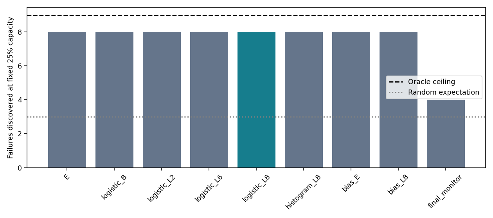
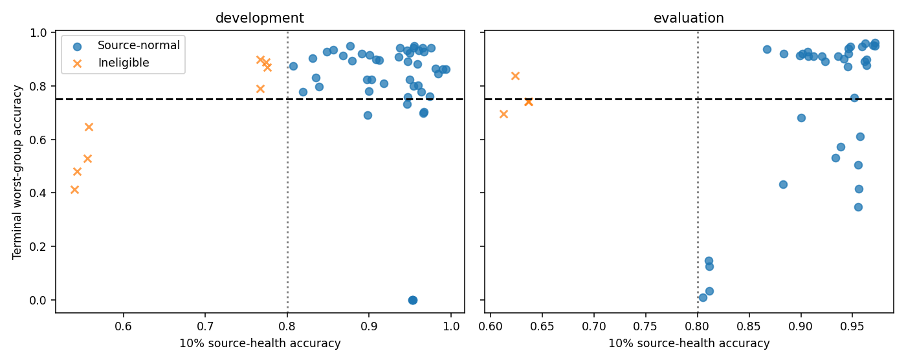
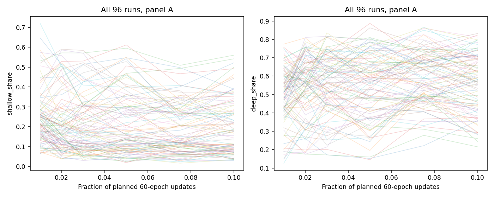

# GradientGuard exploratory outcome proof of concept

No incremental audit value observed in this pilot. All 96 classifiers completed 60 epochs (19,560 optimiser updates each). The intended held-out source-normal cohort contains 36 runs across 9 setting families, with 12 failures and 24 non-failures. The prospective support screen passes.

## Primary audit result

Each method ranks the same source-normal held-out pool. Failure means terminal WGA strictly below 0.75; capacity is floor(0.25N). L8 is logistic regression with the eight prescribed layer summaries. E was selected on development families only. Strongest development-selected non-temporal control: **logistic_B**.

| model | N | k | failures | discoveries | precision | recall | random_expected | oracle_ceiling | headroom | AP | AUROC | Brier |
| --- | --- | --- | --- | --- | --- | --- | --- | --- | --- | --- | --- | --- |
| E | 36 | 9 | 12 | 8 | 0.8889 | 0.6667 | 3 | 9 | 1 | 0.7751 | 0.816 | 0.2036 |
| logistic_B | 36 | 9 | 12 | 8 | 0.8889 | 0.6667 | 3 | 9 | 1 | 0.7612 | 0.7847 | 0.2063 |
| logistic_L2 | 36 | 9 | 12 | 8 | 0.8889 | 0.6667 | 3 | 9 | 1 | 0.7599 | 0.7812 | 0.2061 |
| logistic_L6 | 36 | 9 | 12 | 8 | 0.8889 | 0.6667 | 3 | 9 | 1 | 0.9336 | 0.9618 | 0.1648 |
| logistic_L8 | 36 | 9 | 12 | 8 | 0.8889 | 0.6667 | 3 | 9 | 1 | 0.9336 | 0.9618 | 0.1647 |
| histogram_L8 | 36 | 9 | 12 | 8 | 0.8889 | 0.6667 | 3 | 9 | 1 | 0.9535 | 0.9844 | 0.1531 |
| bias_E | 36 | 9 | 12 | 8 | 0.8889 | 0.6667 | 3 | 9 | 1 | 0.9182 | 0.9514 | 0.1633 |
| bias_L8 | 36 | 9 | 12 | 8 | 0.8889 | 0.6667 | 3 | 9 | 1 | 0.9304 | 0.9583 | 0.1635 |
| final_monitor | 36 | 9 | 12 | 4 | 0.4444 | 0.3333 | 3 | 9 | 5 | 0.7203 | 0.8333 | 0.1737 |

Delta20 is 20 times the difference in discoveries divided by candidate count. A value of at least 1 was the prospective useful-gain target. The intervals below resample whole held-out families with frozen predictions; they are descriptive, conditional intervals, not confirmatory inference and not forecaster-selection uncertainty.

| control | Delta20 | interval_low | interval_high | invalid_resamples | family_count |
| --- | --- | --- | --- | --- | --- |
| E | 0 | -1.111 | 4.444 | 58 | 10 |
| logistic_B | 0 | -1.111 | 4.444 | 58 | 10 |
| logistic_L6 | 0 | 0 | 0 | 58 | 10 |

The fixed-budget result does not show useful incremental discovery over E.

E has room for 1 additional discovery before the oracle ceiling. Its maximum attainable Delta20 headroom is 0.5556, below the prespecified useful-gain target of 1; this pool cannot demonstrate that target against this baseline. Neither useful temporal nor static/global incremental audit value is demonstrated at the fixed budget.

The non-slope L6 control has the same primary discovery count, average precision and AUROC as L8. The improved ranking metrics relative to E therefore do not establish added value from the two layer-share slopes. Shared bias controls also improve ranking metrics without adding discoveries. These secondary changes do not overturn the fixed-budget result.

## Support, eligibility and outcomes

Eligibility is determined independently on the fixed source-health panel at 10%: accuracy >=0.80, CE <=ln(10), finite required measurements. The same 10% cohort definition is used in the secondary 5% analysis. Ineligible runs remain in the full-cohort tables. Classifier settings are grouped into 24 families, not 96 independent settings; 14 families are development and 10 evaluation.

Development support:

| cohort | prefix | classification_supported | n | failures | nonfailures | families | failure_families | nonfailure_families |
| --- | --- | --- | --- | --- | --- | --- | --- | --- |
| eligible | 0.1 | True | 48 | 8 | 40 | 13 | 4 | 12 |
| full | 0.1 | True | 56 | 12 | 44 | 14 | 5 | 12 |
| eligible | 0.05 | True | 48 | 8 | 40 | 13 | 4 | 12 |
| full | 0.05 | True | 56 | 12 | 44 | 14 | 5 | 12 |

Held-out support:

| cohort | prefix | N | families | failures | nonfailures | evaluable | failure_families | nonfailure_families |
| --- | --- | --- | --- | --- | --- | --- | --- | --- |
| eligible | 0.1 | 36 | 9 | 12 | 24 | True | 3 | 6 |
| full | 0.1 | 40 | 10 | 15 | 25 | True | 4 | 7 |
| eligible | 0.05 | 36 | 9 | 12 | 24 | True | 3 | 6 |
| full | 0.05 | 40 | 10 | 15 | 25 | True | 4 | 7 |

There are 0 held-out source-normal families containing both failure labels. The minimum family-support convention passes, but binary outcomes are homogeneous within each eligible held-out family. This experiment therefore cannot demonstrate discrimination between successful and failing seeds inside the same setting family; constructed setting differences remain an important limitation.

Full cohort, panel A, 10%:

| model | N | k | failures | discoveries | AP | AUROC |
| --- | --- | --- | --- | --- | --- | --- |
| E | 40 | 10 | 15 | 9 | 0.9016 | 0.9267 |
| logistic_B | 40 | 10 | 15 | 8 | 0.8674 | 0.8987 |
| logistic_L6 | 40 | 10 | 15 | 8 | 0.7767 | 0.8427 |
| logistic_L8 | 40 | 10 | 15 | 8 | 0.7858 | 0.8533 |

Every completed model has 100 predefined digit/background groups. Outcome groups contain 89 to 135 examples. The report retains all group correct counts, accuracies and nominal 95% Wilson intervals. These marginal binomial intervals are not a simultaneous confidence interval for the minimum WGA. 12 of 96 outcomes lie within 0.05 of the primary cutoff. Neither confidence bounds nor numerical failures redefine the binary label.

Fixed secondary cutoff results (frozen predictions reused without retuning):

| cutoff | model | N | failures | discoveries | oracle_ceiling |
| --- | --- | --- | --- | --- | --- |
| 0.7 | E | 36 | 12 | 8 | 9 |
| 0.7 | logistic_L8 | 36 | 12 | 8 | 9 |
| 0.8 | E | 36 | 13 | 9 | 9 |
| 0.8 | logistic_L8 | 36 | 13 | 9 | 9 |

## Probe, influence and structural controls

Panel A is primary. The frozen A pipeline applied to B and the matched B refit with A-selected hyperparameters are predefined secondary checks. No panel ensemble or favourable-panel substitution was made.

| panel | refit_B | model | N | discoveries | AP | AUROC |
| --- | --- | --- | --- | --- | --- | --- |
| A | False | E | 36 | 8 | 0.7751 | 0.816 |
| A | False | logistic_B | 36 | 8 | 0.7612 | 0.7847 |
| A | False | logistic_L8 | 36 | 8 | 0.9336 | 0.9618 |
| B | False | E | 36 | 8 | 0.7716 | 0.809 |
| B | False | logistic_B | 36 | 8 | 0.763 | 0.7882 |
| B | False | logistic_L8 | 36 | 8 | 0.9336 | 0.9618 |
| B | True | E | 36 | 7 | 0.7828 | 0.8472 |
| B | True | logistic_B | 36 | 7 | 0.7724 | 0.8299 |
| B | True | logistic_L8 | 36 | 8 | 0.928 | 0.9618 |

| control | panel_A_Delta20 | panel_B_frozen_A_Delta20 | panel_B_refit_Delta20 | leave_family_out_min | leave_family_out_max |
| --- | --- | --- | --- | --- | --- |
| E | 0 | 0 | 0.5556 | -0.625 | 2.5 |
| logistic_B | 0 | 0 | 0.5556 | -0.625 | 2.5 |
| logistic_L6 | 0 | 0 | 0 | 0 | 0 |

All ten held-out families, including those contributing no eligible candidate, enter family resampling. Duplicated family draws retain their nested constructions/seeds; ranking, N and k are recomputed. Leave-one-family-out contrasts are in leave_one_family_out.csv. Only ten independent setting groups remain, and outcome panels and underlying MNIST images are shared.

Separate conv3/head totals, common-denominator shares, convolution-only shares, per-weight means and bias diagnostics are in structural_checkpoint_diagnostics.csv. Deep = conv3 + head was numerically verified at every recorded point. At 10% on panel A and the selected 256/class budget, 0/96 runs have head sensitivity >=50% of deep and 0/96 have bias sensitivity >=10% of total weight sensitivity. Shared bias_E/bias_L8 controls appear in the primary table. These observations do not resolve causal or architectural interpretation.

## Secondary continuous outcome and lead time

| model | MAE | spearman |
| --- | --- | --- |
| ridge_B | 0.1671 | 0.7006 |
| ridge_E | 0.165 | 0.7088 |
| ridge_L2 | 0.1684 | 0.681 |
| ridge_L6 | 0.1588 | 0.7036 |
| ridge_L8 | 0.1473 | 0.709 |

Ridge regression is a separately labelled secondary WGA analysis; it cannot rescue inadequate binary support. Ordinary final monitoring uses final source-health CE, accuracy and learning rate, selected only on development families. Its audit result is included above. Early predictions use six actual epochs, leaving 54 planned training epochs (17,604 updates) before the terminal model. This establishes observation timing, not a demonstrated deployment benefit or an optimal final-monitoring comparator.

## Frozen design and operation order

CNN A was trained from scratch with float32, no AMP/TF32 shortcuts, deterministic operations, Adam with no weight decay, batch 128 including the last four-example batch, and no augmentation. All families ran the fixed 60-epoch horizon without outcome-based stopping. The horizon is an explicit exploratory amendment: the prior 60-epoch calibration candidate failed its all-three-seeds gate. That gate remains failed.

The 24 Cartesian families cover alignment 0.10/0.50/0.80/0.95, LARGE/MEDIUM difficulty and learning rate 0.0003/0.001/0.003, with two seeded constructions and two initialisations each. All identities and the family-disjoint 14/10 split were frozen before outcomes. Both sides cover every configuration level. The official SpuCo generator was checked pixel-for-pixel for all 48 source constructions. LARGE changes zero-background pixels across the image; MEDIUM uses a 4x4 corner mask. Foreground pixels and ordinary labels were preserved. Each source has 48,004 original training identities, with disjoint A/B reservations of 256 per class, health of 128 per class, and 41,604 training images.

Terminal development outcomes use official validation identities, held-out outcomes official test identities. Common group-balanced panels are generated per difficulty with prespecified seeds. These are not independent new image populations. Background assignments are offline metadata and never predictor inputs.

The audit log verifies: design freeze; development training/validation outcomes; predictor freeze; held-out training; early-prediction freeze; terminal-test unseal. Predictor freeze time_ns=1794853167551757700, prediction freeze=1794856311189748100, unseal=1794856318916967800. Pipeline and prediction hashes still match. No preprocessing was fitted on combined development/evaluation records. Final source fields and terminal labels are absent from the exported early predictor table; exactly eight layer features are exported separately for each panel/prefix.

Environment: Python 3.12.14, torch 2.7.1+cu128, torchvision 0.22.1+cu128, CUDA runtime 12.8, RTX 5060 Ti. Complete environment, driver, SpuCo source/commit hashes, deterministic settings and project-local cache settings are retained. Installed versions were preserved. Reproducibility across other hardware/software is not promised.

## Implementation validation and costs

All 21 integration checks passed. The automated synthetic/read-only checks cover family/CV separation, forbidden inputs, fold-local preprocessing, exact feature summaries, gradient accumulation/isolation and parity with the original gradient definition, both official masks, old-artifact preservation, predictor-unseal gates, future-record independence, strict audit budgets/ties, numerical resume and an intentional interruption/resume of the actual runner on a separately labelled fixture. Full scientific models were independently checked for finite weights/telemetry, the six planned early measurements, final optimiser steps and 60-epoch completion. These are implementation checks, not evidence of predictive value.

Summed recorded training time: 94.14 minutes; six-checkpoint panel A monitoring: 5.20 minutes; additional panel B monitoring: 5.29 minutes; early source-health: 5.10 seconds; diagnostic initialisation monitoring: 1.93 minutes. Classifier invocation wall totals 109.72 minutes. Panel A includes conventional telemetry, clustering and sensitivity, so this is not an isolated incremental GradientGuard cost. Panel B is validation overhead. Representative initial full run and extrapolation are retained in representative_profile.json.

Maximum recorded allocated GPU memory: 567.2 MiB. The counter is cumulative within each process and does not give isolated incremental probe memory, total GPU allocation by other applications or CPU peak memory. Compact source storage is 57.6 MiB and classifier storage 110.3 MiB. Full RGB duplicates are not stored. Dataset preparation, terminal evaluation and forecaster fitting were not individually timed; their actual separate component costs are unavailable. End-to-end time includes engineering/wait overhead and is retained in costs.json. These instrumentation gaps limit precise production-cost claims.

## Interpretation and remaining limitations

The preserved first result reproduced at approximately 3.050141, but the marginal deep-slope finding passed only 15/20 alternative partitions against a 16/20 screen. Structural interpretation and source-health calibration remained unresolved, and the planned fresh 18-prefix study was not launched. This PoC does not retrospectively pass those gates.

The nonlinear control uses the frozen bounded histogram implementation with min_samples_leaf=20. Some grouped training folds are too small for any split; this weakens the claim of comparison against a strong nonlinear conventional predictor. The actual defaults are recorded, and were not changed after outcomes to improve results. Prediction depth is deferred. The final-monitoring comparator is limited to source-health CE/accuracy. The 96 classifiers share MNIST and only 24 setting families; held-out uncertainty uses ten families and does not include development selection uncertainty. Finite group samples, cutoff-near outcomes, limited failure diversity and probe sensitivity require caution.

No incremental audit value observed in this pilot. A positive coefficient, higher AUROC, static improvement or successful execution alone does not establish temporal incremental audit value, shortcut causality or novelty. Any follow-up must be separately frozen; this study is not journal-ready confirmation.

If research continues, design a separate study with more held-out families, genuine within-setting outcome variation and enough audit headroom to test the prospective gain. Strengthen the nonlinear comparator under its actual fold sizes and implement the deferred prediction-depth comparator. Do not append favourable runs, retune on these held-out outcomes or promote the secondary static/ranking findings into a temporal success claim.

## Files and reproduction

Main decision: decision.json. Primary metrics: metrics.csv and contrasts.csv. Cohort accounting: completion_and_health.csv, family_coverage_and_diversity.csv, evaluation_support.csv and ../development_support.csv. Outcomes and finite-group diagnostics: terminal_outcomes.csv and group_accuracy_uncertainty.csv. All audit selections: audit_selections.csv. Robustness: primary_robustness_summary.csv and leave_one_family_out.csv. All early raw observations/checkpoints: ../classifiers/<run>/. Seeds/configuration: ../protocol.json and ../run_manifest.csv. Predictor choices, inputs, folds and hashes: ../predictor_freeze.json. Instructions: E:\Final Year Project\Implementation\Feasibility\instructions\STEP_BY_STEP_POC.txt.

