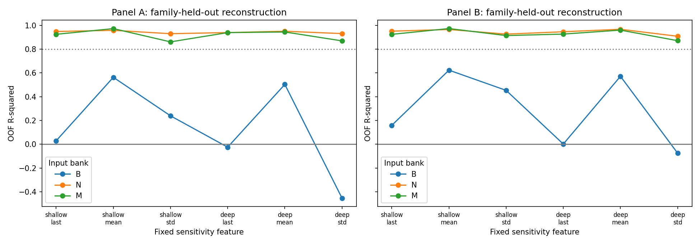
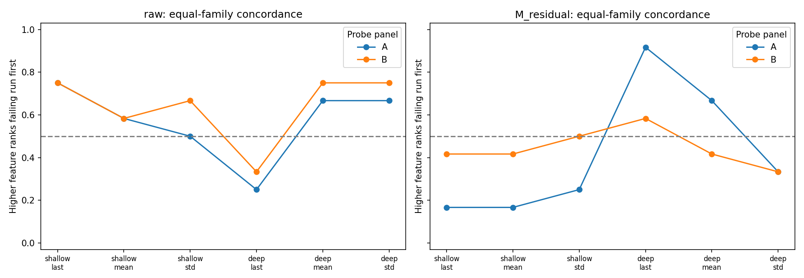

# GradientGuard: bounded development-only diagnosis

Attempt **20261122_devdiag01**. Post-hoc exploratory diagnosis of development evidence from `20261122_fresh02`. The previous held-out result is already known; this work does not restore untouched evaluation or validate a newly selected method.

## Supervisor-style conclusion

**Pause the current sensitivity-specific claim; narrow the FYP or justify a materially different representation before more classifier training.** The diagnosis is useful for explaining limitations, not for rescuing the previous primary tie. Substantial linear reconstructability in at least four of six features. Within-setting outcome comparisons involve only **4 source-normal mixed-outcome families**. That is too narrow to establish a transferable model-level failure signal. These conclusions do not mean all layer information is useless or that the original implementation was incorrect.

My assessment as a research supervisor would be: the implementation and controlled negative result are credible FYP achievements. The sensitivity-specific superiority claim should not currently carry the dissertation or journal argument. Preserve the completed investigation; discuss a narrower comparative contribution with the actual supervisor. A new method or benchmark is warranted only after identifying a distinct, testable mechanism and agreeing a realistic scope. This document is advisory and is not the supervisor's institutional approval.

## What ran and what stayed fixed

Only saved development feature tables, validation-based labels, original family folds, bank column definitions and existing development OOF scores were semantically loaded. No evaluation features, predictions or test outcomes were loaded into these analyses. Protected evaluation files were byte-hashed for preservation only. No binary pipelines were loaded, no CNN was trained, and no failure forecaster was fitted or retuned. Fixed auxiliary Ridge regressions predicted the six features themselves, without failure labels, at alpha=1 and CPU float64. Preprocessing and target scaling were fitted inside each training fold. No grid search, bank selection or feature deletion occurred. Both probe panels use identical development identities and family folds.

The plan, seed, exact formulas, source hashes, input hashes and preservation manifest were frozen before new statistical calculations. The full recorded package lock matches. Synthetic tests are separate. No previous artifact, proposal, manuscript, scientific gate or predictor freeze was amended. The four unavailable development models remain unavailable and were not replaced.

## Development support

| cohort | N | families | failures | nonfailures | mixed_family_models | folds |
| --- | --- | --- | --- | --- | --- | --- |
| eligible | 107 | 29 | 38 | 69 | 16 | 5 |
| full | 124 | 32 | 50 | 74 | 24 | 5 |

Primary source-normal analysis therefore includes 107 models, but only 12 failure/nonfailure pairs in 4 mixed families inform within-family discrimination. Of these pairs, 4 share a source construction and differ by initialisation; the others also differ by construction. Pairs share models and are not independent experimental units. All homogeneous families remain in reconstruction and variance analyses; they cannot contribute a failure/nonfailure comparison within their family. Family-level pair counts and identities are retained.

## Do the six features repeat existing information?

The table reports out-of-fold R-squared when reconstructing each Z feature from B (conventional/global), N (adds norm-product allocation) and M (adds rich structural statistics/bias). Validation families are absent from that fold's regression training. A score near1 means successful reconstruction; zero is no better than the pooled target mean; negative is worse. The separately exported skill score uses the fold-training mean baseline. All six features are retained in this report, including poor or negative reconstruction scores.

| feature | A_B_R2 | A_N_R2 | A_M_R2 | B_B_R2 | B_N_R2 | B_M_R2 |
| --- | --- | --- | --- | --- | --- | --- |
| shallow_share_last | 0.0296 | 0.9477 | 0.9241 | 0.1595 | 0.9505 | 0.9238 |
| shallow_share_mean | 0.5629 | 0.9576 | 0.9720 | 0.6229 | 0.9647 | 0.9725 |
| shallow_share_std | 0.2392 | 0.9292 | 0.8606 | 0.4531 | 0.9256 | 0.9136 |
| deep_share_last | -0.0243 | 0.9388 | 0.9384 | 0.0019 | 0.9457 | 0.9261 |
| deep_share_mean | 0.5031 | 0.9498 | 0.9438 | 0.5712 | 0.9662 | 0.9594 |
| deep_share_std | -0.4521 | 0.9302 | 0.8690 | -0.0746 | 0.9077 | 0.8706 |

Panel-A M reconstruction has median R-squared **0.9313**, with **6/6** features reaching the predeclared descriptive0.8 marker. High reconstructability supports possible information overlap, but does not prove that residual sensitivity has no relationship with outcomes. Low R-squared only limits this fixed linear reconstruction: nonlinear overlap, regularisation and small family coverage may still matter. These regressions are not failure-prediction models and their scores cannot be compared directly to audit discoveries.

## Is variation mostly between settings?

| feature | between_fraction | within_fraction | sd |
| --- | --- | --- | --- |
| shallow_share_last | 0.8251 | 0.1749 | 0.1108 |
| shallow_share_mean | 0.9182 | 0.0818 | 0.1099 |
| shallow_share_std | 0.7675 | 0.2325 | 0.0313 |
| deep_share_last | 0.7686 | 0.2314 | 0.1367 |
| deep_share_mean | 0.9016 | 0.0984 | 0.1137 |
| deep_share_std | 0.6790 | 0.3210 | 0.0321 |

Fractions are an exact run-weighted sample sum-of-squares decomposition, not estimates of population variance components. Large between-family fractions mean a feature mainly separates settings in these data; they do not establish which setting attribute causes the difference. Within-family variability can contain training-seed effects, source-construction effects and probe variation. Matched norm-product correlations and paired-panel noise/spread tables report those descriptive limits separately. Panel A/B comparisons do not measure numerical jitter or provide independent dataset replications.

## Can the features separate outcomes within one setting?

The fixed orientation is larger feature means greater failure risk: concordance1 means every failing/non-failing pair is correctly ordered,0 reverses that ordering and0.5 is tied/random ordering. A value below0.5 may describe an inverse association; no direction was selected to build a new predictor. Each mixed family receives equal weight. M_residual subtracts family-held-out M reconstruction; it does not residualise outcome labels or establish conditional causal effects.

| panel | representation | feature | concordance | leave_one_family_min | leave_one_family_max | two_sided_conditional_p | max24_adjusted_p |
| --- | --- | --- | --- | --- | --- | --- | --- |
| A | raw | shallow_share_last | 0.7500 | 0.6667 | 1.0000 | 0.2734 | 0.9844 |
| A | raw | shallow_share_mean | 0.5833 | 0.4444 | 0.7778 | 0.8281 | 1.0000 |
| A | raw | shallow_share_std | 0.5000 | 0.3333 | 0.6667 | 1.0000 | 1.0000 |
| A | raw | deep_share_last | 0.2500 | 0.0000 | 0.3333 | 0.2734 | 0.9844 |
| A | raw | deep_share_mean | 0.6667 | 0.5556 | 0.8889 | 0.5156 | 1.0000 |
| A | raw | deep_share_std | 0.6667 | 0.5556 | 0.8889 | 0.5156 | 1.0000 |
| A | M_residual | shallow_share_last | 0.1667 | 0.1111 | 0.2222 | 0.1172 | 0.8633 |
| A | M_residual | shallow_share_mean | 0.1667 | 0.0000 | 0.2222 | 0.1172 | 0.8633 |
| A | M_residual | shallow_share_std | 0.2500 | 0.1111 | 0.3333 | 0.2734 | 0.9844 |
| A | M_residual | deep_share_last | 0.9167 | 0.8889 | 1.0000 | 0.0391 | 0.4844 |
| A | M_residual | deep_share_mean | 0.6667 | 0.5556 | 0.7778 | 0.5156 | 1.0000 |
| A | M_residual | deep_share_std | 0.3333 | 0.2222 | 0.4444 | 0.5156 | 1.0000 |
| B | raw | shallow_share_last | 0.7500 | 0.6667 | 1.0000 | 0.2734 | 0.9844 |
| B | raw | shallow_share_mean | 0.5833 | 0.4444 | 0.7778 | 0.8281 | 1.0000 |
| B | raw | shallow_share_std | 0.6667 | 0.5556 | 0.7778 | 0.5156 | 1.0000 |
| B | raw | deep_share_last | 0.3333 | 0.1111 | 0.4444 | 0.5156 | 1.0000 |
| B | raw | deep_share_mean | 0.7500 | 0.6667 | 0.8889 | 0.2734 | 0.9844 |
| B | raw | deep_share_std | 0.7500 | 0.6667 | 0.7778 | 0.2734 | 0.9844 |
| B | M_residual | shallow_share_last | 0.4167 | 0.2222 | 0.5556 | 0.8281 | 1.0000 |
| B | M_residual | shallow_share_mean | 0.4167 | 0.2222 | 0.5556 | 0.8281 | 1.0000 |
| B | M_residual | shallow_share_std | 0.5000 | 0.3333 | 0.6667 | 1.0000 | 1.0000 |
| B | M_residual | deep_share_last | 0.5833 | 0.4444 | 0.7778 | 0.8281 | 1.0000 |
| B | M_residual | deep_share_mean | 0.4167 | 0.2222 | 0.5556 | 0.8281 | 1.0000 |
| B | M_residual | deep_share_std | 0.3333 | 0.2222 | 0.4444 | 0.5156 | 1.0000 |

Conditional label reassignment preserves each family's failure count. The maximum-departure adjustment covers all24 raw/residual feature-panel combinations within each cohort. Exact/Monte Carlo counts are recorded in `conditional_permutation.json`; Monte Carlo uses a frozen seed and plus-one counts. These are retrospective descriptive randomisation diagnostics, relying on an exchangeability assumption across constructions/initialisations. They do not eliminate the small-family problem, shared images, prior research selection or multiplicity across the research history. There are **0** feature/representation combinations meeting the descriptive same-direction, adjusted-p and family-omission consistency check on both panels. Even such a pattern is only a development clue, not a passed independent gate.

## What do the already-existing forecasters show within families?

| model | concordance |
| --- | --- |
| logistic_B | 0.5833 |
| logistic_L6 | 0.5000 |
| logistic_M | 0.3333 |
| logistic_MZ | 0.3333 |

These use the previously saved development out-of-fold risk scores, with no new training. Their hyperparameters and banks were selected using development outcomes, so this is optimistic development evidence rather than an independent test. A tiny within-family sample can produce coarse changes in concordance. It cannot establish robust within-setting seed discrimination or overturn the completed held-out result.

## My recommended decision

1. Keep the original and fresh results, including their ties, panel loss and any smaller-control improvements. Do not rewrite the primary endpoint as a success.
2. Explain the project as a tested investigation of the incremental value of layer information. The current evidence does not justify claiming sensitivity-specific novelty, a causal shortcut detector or journal readiness.
3. Present this diagnosis to the actual supervisor before further compute. If continuing, require a clearly different, development-justified hypothesis; changing learners, budgets or features against the consumed evaluation set is not fresh validation.
4. If no such hypothesis is defensible within the timeframe, finish a rigorous comparative/negative-result FYP with the working audit application and reproducible evidence. More runs of an unchanged representation are not the default next step.

No manuscript version or proposal was changed, and no follow-on training is launched. The diagnosis may suggest reasons for the old result but cannot identify a unique explanation or prove mathematical redundancy.

## Files and reproduction

New code: `layer_allocation/development_diagnostics`. Exact PowerShell commands: `instructions/STEP_BY_STEP.txt` in that folder. Numerical outputs: `layer_allocation/runs/20261122_devdiag01`. Report and figures: `layer_allocation/reports/20261122_devdiag01`. Read `plan_freeze.json`, `semantic_read_audit.json`, `preprocessing_audit.json`, `preservation_after.json`, `conditional_permutation.json`, all score/pair tables and `tests.xml`. The results are conditional on the fixed constructions that passed the official generator; missing high-alignment constructions remain disclosed.
