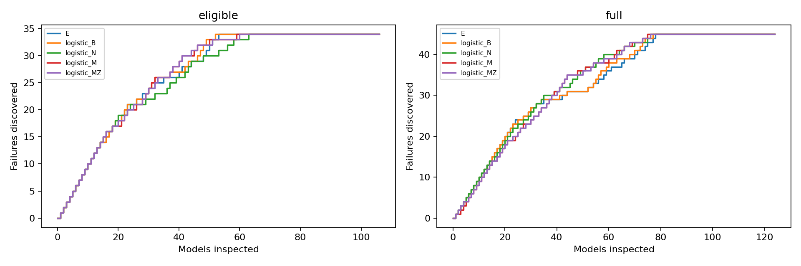
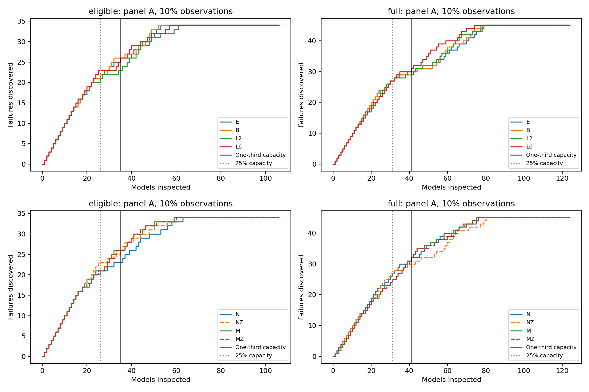
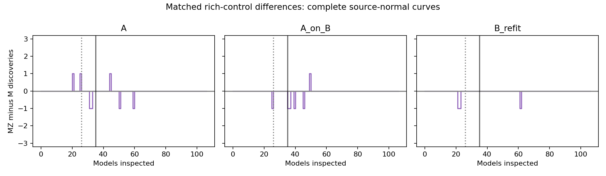
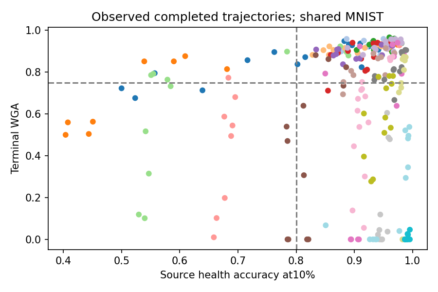

# GradientGuard amended fresh-family validation

Attempt **20261122_fresh02** — 22 November 2026.

**The experiment completed and was adequately evaluable. It did not demonstrate the predefined sensitivity-specific improvement.** At the prospectively frozen one-third capacity, logistic MZ and logistic M each discovered **26 of 34 failures in 35 inspections**. Adding the six connection-sensitivity summaries did not improve that primary decision. This is evidence about the tested representation, controls and available SpuCoMNIST pool, not a disproof of every possible layer-information approach.

## Execution, amendment and preservation

Of 128 planned development models, 124 completed training; four were unavailable because two fixed 0.99-alignment source constructions failed the official generator's group-presence validation. All completed development models were retained and reused, **not retrained**. The original stopped attempt and its failed complete-development execution requirement remain unchanged.

All 64 evaluation source constructions were preflighted after predictor freezing and before evaluation training. Two fixed constructions were rejected by the same official assertion, leaving 124 available evaluation models. All 124 completed 60 epochs, or 19,560 optimiser updates, without numerical divergence. Overall: **256 planned, 248 complete (124 reused + 124 newly trained), eight data-unavailable, zero diverged and zero incomplete**. Development exclusions are families 61 construction 1 and 62 construction 0; evaluation exclusions are families 56 construction 0 and 59 construction 0. Each rejected construction accounts for two planned initialisations. Seeds were not replaced, assertions were not disabled, and other valid constructions remained in their assigned families.

Missingness is concentrated at 0.99 alignment; it is not assumed random or harmless. Results are conditional on successfully constructed candidates. Exact identities, seeds and official rejection reasons are in `unavailable/`, with configuration and family accounting tables in the attempt.

The complete recorded dependency environment matches: Python 3.12.14, torch 2.7.1+cu128, torchvision 0.22.1+cu128, CUDA runtime 12.8, RTX 5060 Ti. No environment repair, package change, global installation or security change was needed. Twenty-three automated checks passed. Completed-output audits verified imported development bytes, checkpoint hashes, full horizons, schedules, source/configuration freezes, matched panels/banks and bounded complete curves. All 7,171 protected inputs were unchanged; an independent repository audit also verified 1,813 original scientific files unchanged.

## Information boundary and support

The amendment explicitly changed only the all-128-development execution requirement. Development outcomes were already known. The original design, family assignments, seeds, 60-epoch horizon, health rule, WGA cutoffs, feature banks, tuning grids and statistical gates remained fixed. The amended freeze preceded verified development support and predictor fitting; fitted predictors preceded all-source evaluation preflight/training; early risks and eligibility were frozen before the one-time test unseal. No tuning followed evaluation outcomes.

Development source-normal support: 107 models in 29 families; 38 failures in 14 families and 69 non-failures in 19 families, with four mixed-outcome families and valid five-fold grouped CV. Evaluation source-normal support: **106 models in 28 families; 34 failures in 12 families and 72 non-failures in 20 families**, including 4 mixed-outcome families. All original minimum support requirements pass. The full evaluation cohort contains 124 completed models and is reported separately. Trajectories are nested in families and share MNIST; they are not 248 independent experimental settings.

## Frozen primary and secondary audit results

Panel A is primary; observation is the first 10% of planned updates. E is the development-selected conventional predictor. B adds global sensitivity. L2 adds layer endpoints; L6 adds six shallow/deep endpoint, mean and population-SD shares. N adds norm-product allocation; NZ adds those six sensitivity shares. M is the rich matched structural control; MZ adds exactly the same six shares. Slopes are not primary inputs. E and the strongest non-Z control were selected using development families only; the selected non-Z control was **logistic_M**.

| Frozen model | Discoveries / 35 audits | Discoveries / 26 audits | AP | AUROC | Brier |
| --- | --- | --- | --- | --- | --- |
| E | 26 | 22 | 0.8719 | 0.9289 | 0.1121 |
| logistic_B | 26 | 22 | 0.8804 | 0.9355 | 0.1071 |
| logistic_L2 | 23 | 21 | 0.8524 | 0.9118 | 0.1173 |
| logistic_L6 | 26 | 23 | 0.8838 | 0.9334 | 0.1030 |
| logistic_N | 23 | 21 | 0.8505 | 0.9081 | 0.1183 |
| logistic_NZ | 26 | 23 | 0.8872 | 0.9342 | 0.1037 |
| logistic_M | 26 | 21 | 0.8790 | 0.9359 | 0.1024 |
| logistic_MZ | 26 | 21 | 0.8795 | 0.9355 | 0.1022 |
| histogram_E | 27 | 23 | 0.8806 | 0.9363 | 0.1115 |
| histogram_B | 27 | 22 | 0.8856 | 0.9375 | 0.1072 |
| histogram_L6 | 28 | 23 | 0.8897 | 0.9395 | 0.1055 |
| histogram_N | 27 | 21 | 0.8783 | 0.9355 | 0.1105 |
| histogram_NZ | 27 | 22 | 0.8902 | 0.9371 | 0.1037 |
| histogram_M | 26 | 21 | 0.8564 | 0.9073 | 0.1117 |
| histogram_MZ | 26 | 21 | 0.8564 | 0.9073 | 0.1117 |

For N=106, failure prevalence is 32.08%, the primary budget is 35 and the secondary 25% budget is 26. Random inspection expects 11.226 failures at the primary budget; the oracle ceiling is 34. M and MZ both have eight further discoveries of oracle headroom. The useful-gain target Delta20 >= 1 was attainable in principle, but the observed primary Delta20 is **0**.

The matched primary 95% whole-family interval is **[-0.2083, 0.1888]** in Delta20 units, with 5,000 valid draws and zero invalid draws. It includes zero. This interval is conditional on frozen predictors and realised families, not a population equivalence proof or a powered confirmatory claim.

The saved-pipeline lineage audit confirms that all six Z columns survive preprocessing and reach each MZ estimator in both learner classes, both fitted panels and all cohort/prefix pipelines (96 retained feature records). The tie therefore does not arise from silently omitting the added six inputs. Frozen pipeline and prediction files remained byte-identical during inspection.

There are limited supporting gains: logistic NZ finds three more failures than N, and L6 finds three more than L2 at one-third capacity. L6 finds one more than E/B at the secondary 25% capacity. Histogram L6 finds 28 at one-third, compared with histogram E/B's 27. These are smaller-control or secondary findings; they do not establish improvement over rich M or satisfy the sensitivity-specific primary gate. All histogram M/MZ primary results tie. No favourable budget or learner is promoted after evaluation.

## Panels, families and whole curves

| Panel procedure | MZ | M | Difference | 95% family interval (Delta20) | LOFO difference range |
| --- | --- | --- | --- | --- | --- |
| A | 26 | 26 | 0 | [-0.2083, 0.1888] | 0 to 0 |
| A_on_B | 27 | 28 | -1 | [-0.3571, 0.1818] | -1 to 0 |
| B_refit | 27 | 27 | 0 | [-0.1961, 0.1696] | 0 to 0 |

A_on_B applies the frozen A predictor to B measurements. B_refit uses the already-frozen A hyperparameter choices with development B fitting, performed before held-out outcomes. Neither replaces panel A. The primary MZ-M tie becomes a **one-discovery loss** under A_on_B and remains a tie under B_refit. All 32 panel-A family omissions retain a zero primary difference; this is absence of a gain, not robustness of a positive effect. Other panel/family comparisons, including gains and losses, remain in the detailed tables.

Complete panel-A curves use every budget 0 through 106; the counts below include both endpoints and correlated adjacent budgets. They are descriptive, not multiple independent tests.

| Added model | Control | Minimum difference | Maximum difference | Budgets ahead | Tied | Behind |
| --- | --- | --- | --- | --- | --- | --- |
| logistic_MZ | logistic_M | -1 | 1 | 3 | 100 | 4 |
| logistic_L6 | E | -2 | 2 | 20 | 77 | 10 |
| logistic_L6 | logistic_B | -3 | 2 | 14 | 78 | 15 |
| logistic_NZ | logistic_N | 0 | 3 | 39 | 68 | 0 |

The separately labelled full cohort contains 45 failures among 124 models. At its recomputed one-third budget of 41 audits, E/B/L6/M/MZ discover 29/30/31/32/32 respectively; MZ-M still ties. At 31 audits (25%), the same methods discover 27/27/27/25/25. These full-cohort observations do not replace the intended source-normal analysis.

All cohorts, prefixes (10% primary and 5% secondary), learner variants, panel variants, fixed 0.70/0.80 failure-cutoff sensitivities, AP/AUROC/Brier metrics and negative comparisons are archived. See `metrics.csv`, `contrasts.csv`, `intervals.csv`, `secondary_cutoffs.csv`, `discovery_curves.csv` and `leave_one_family_out.csv`. Bootstrap and omissions keep whole families intact, including families without eligible models, and recompute candidate sizes and budgets. Intervals are pointwise and exclude forecaster-selection uncertainty. Group-level counts and marginal Wilson intervals are in `group_accuracies.csv`; they are not simultaneous uncertainty bounds for the minimum group. Cutoff-near cases remain visible.

## Costs and limits

The combined conservative GPU-stage ledger is **5.239 hours**, including 9,401.188 seconds charged to the original attempt, within the unchanged 24-hour cap. The amended all-stage invocation took 2.688 hours. Summed component timings over all completed imported/new models are training 3.934 hours, panel A monitoring 811.3 seconds, panel B validation 825.8 seconds, diagnostic initialisation 299.0 seconds and early health 12.7 seconds. These component totals are not an extra charge on top of the combined ledger. Per-split per-model records are in `classifier_costs.csv`.

Compact cached evaluation-source arrays use 9.93 MiB; local classifier checkpoints use 275.72 MiB. Identity/background manifests are additional storage. The largest recorded allocated GPU peak is 575.0 MiB; allocator peaks may be cumulative within their original process and are not isolated incremental-probe peaks. CPU peak memory is not available. Panel A monitoring includes conventional telemetry, structural diagnostics and bounded output clustering, so an isolated incremental cost for Z is not established. Source preparation, forecaster selection and research validation overhead are not equivalent to the cost of a single production monitoring panel. No economic audit savings have been demonstrated.

## Scientific decision and manuscript

**Implementation correctness:** passed. **Evaluability:** passed. **Sensitivity-specific primary benefit:** not supported in this study. **Operational benefit:** not established. Some secondary/limited-control improvements are worth preserving, but their panel dependence and failure to beat the rich matched primary control prevent promotion to the central claim.

Recommendation: **revise or pause investment in the current sensitivity-specific representation**, discuss these fresh results with the supervisor, and use the matched-control result to narrow the research claim. Do not automatically expand the grid, retune on these outcomes, launch Waterbirds or claim that a larger replication will make the existing feature bank succeed. Any materially revised representation or experiment needs a separately justified protocol and fresh evaluation. The result does not establish causal shortcut detection, sensitivity-specific novelty, transfer to natural images or within-setting discrimination across all families. Prediction depth and full reproductions of competing systems remain missing comparators.

The manuscript-update gate is **failed**. No v1.3 is created; v1.2 and the proposal remain unchanged. This report and decision record include unfavourable results rather than changing the manuscript gate.

## Reproduction and artifacts

Protocol, environment/lock, source snapshot, seed/run/family manifests, readiness, predictor and prediction freezes, chronological events, source preflight, early features, terminal group outcomes, cost records and all scalar analyses are under `layer_allocation/runs/20261122_fresh02`. Binary classifier weights and raw/cached arrays stay project-local; compact evidence and frozen forecasters are published according to repository policy.

Instructions: `layer_allocation/amended_validation/instructions/STEP_BY_STEP.txt`. Use the documented resume wrapper only if a process was interrupted; never run it concurrently. The completed-output audit is `layer_allocation/complete_amended_validation.py`; readable synthesis is `layer_allocation/interpret_amended_validation.py`. Reports regenerate from existing frozen evidence without classifier training, forecaster refitting or new outcome selection. Run the completion audit again after this synthesis to refresh preservation and final artifact hashes.

## Amendment and completed-output audit
Of 128 planned development models, 124 completed training; four were unavailable because two fixed 0.99-alignment source constructions failed the official generator group-presence validation. All completed development models were retained and reused, not retrained.

Status accounting: {"('development', 'complete')": 124, "('development', 'data_preparation_failed')": 4, "('evaluation', 'complete')": 124, "('evaluation', 'data_preparation_failed')": 4}. All64evaluation source constructions were preflighted before evaluation training. Unavailable evaluation identities were recorded without inspecting model performance. Missingness is concentrated in extreme-alignment settings and is not assumed random or harmless. Comparative results are conditional on successfully constructed candidates.

All imported development bytes checked unchanged; frozen protocol/source and 7171 prior-input hashes pass. Predictor freeze precedes evaluation preflight/training; risk freeze precedes one-time test unseal. Matched columns, panels, candidate pools, complete curves and full19,560-update horizons passed completed-output checks. Original source-normal support, grid, seeds, numerical environment, learner grids, capacities and manuscript criteria remain unchanged.

The24-hour conservative GPU-stage cap includes9401.188seconds from the original attempt. Current combined ledger: 5.239hours. No global packages or security settings changed. Source preparation failures are not subgroup-failure labels or numerical divergence.
